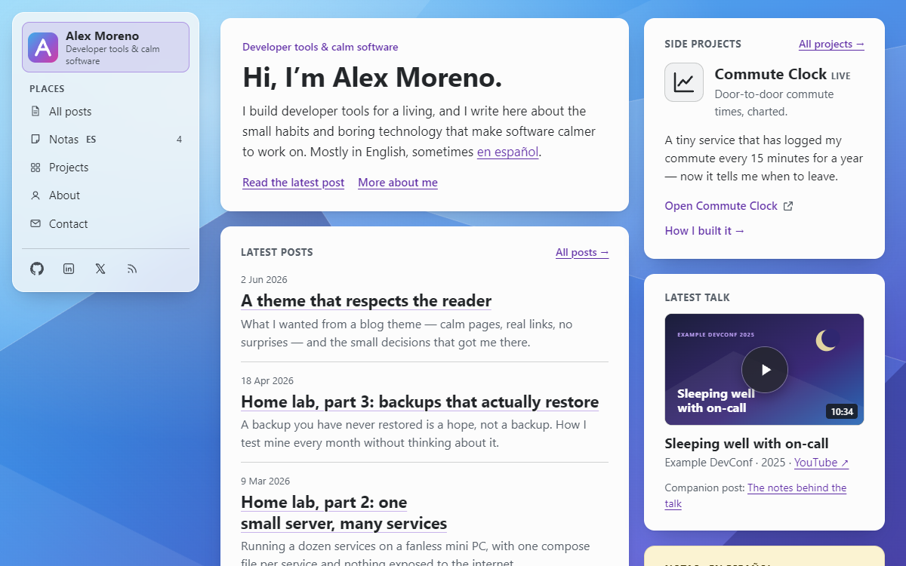
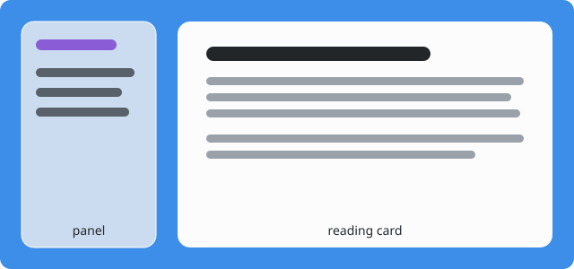

Most blog themes are designed to be looked at. I wanted one that is designed to be *read*: a page that loads fast, works without JavaScript, respects the reader's colour scheme, and gets out of the way once the first paragraph starts.

This post doubles as the theme's style check, so every Markdown element shows up at least once.

## Start from the reading column

Long-form text is happiest at around 65 characters per line. The reading column here is `33em` wide and set in a serif face, while headings, captions and code stay in the interface font.

> Typography exists to honor content.
>
> — Robert Bringhurst

A blockquote is a thin accent rule and italics — nothing more.

### Lists, nested

- Real pages for every section, series, tag and year group
  - so links work without JavaScript
  - and every filter has a shareable URL
- One translucent layer (the navigation panel); everything you read is opaque
- Light and dark follow the operating system

1. Write the HTML first.
2. Make it look right with CSS.
3. Only then add JavaScript, and only where it helps.

## Code

Inline code like `hugo server -s exampleSite` sits on a soft chip. Code blocks use Hugo's class-based highlighter, so the colours live in the theme's stylesheet:

```bash
# build the example site and check the page weights
hugo --source exampleSite --minify
find exampleSite/public -name '*.html' | head
```

```go
// Package weights reports how heavy a page is.
package weights

func Total(sizes ...int) (sum int) {
	for _, s := range sizes {
		sum += s
	}
	return sum
}
```

```css
:root {
  --accent: light-dark(#8a5cd6, #a77bff);
}
```

## Images

Markdown images in a page bundle are resized and converted to WebP at build time, with width and height set so nothing jumps while the page loads. A title turns the image into a figure with a caption:



Vector images pass straight through:



## Tables

| Page    | Budget  | Typical |
|---------|---------|---------|
| Home    | 200 KB  | < 100 KB |
| Archive | 200 KB  | < 100 KB |
| Post    | 200 KB  | < 100 KB |

## What I left out

No web fonts, no analytics, no comments widget, no cookie banner. A [privacy-friendly video player](/blog/sleeping-well-with-on-call/) loads YouTube only when you press play.

---

If you want the same theme, it's open source — see the [projects page](/projects/).
