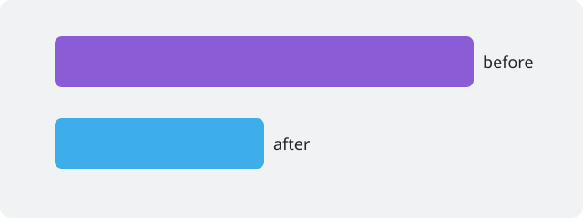

This post uses top-level `#` headings on purpose, so it shows how the theme handles them (see `params.post.shiftheadings`).

# Why we moved

We had outgrown the old build farm. Queues were long, caches were cold and nobody trusted the dashboards.

# What we measured first

Before changing anything we measured three things: time to first green build, cache hit rate, and how often people retried a build without changing anything.

# The plan

Move one team at a time, keep both systems running, and only delete the old one when nobody had used it for a month.

# Week one

The first team moved in a day. The second took a week, because their build depended on a tool that only existed on one machine.

# Week two

We wrote down every machine-only tool we found. The list had nineteen entries. The tracking issue lived at https://example.org/projects/build-migration/issues/machine-only-tools-inventory-and-replacement-plan-2026 and grew every day.

# Caches

Remote caching halved the median build time.

It also made the slowest builds slower, until we fixed the cache keys.

## Cache keys

A cache key should name everything that changes the output, and nothing else. Ours included the build machine's hostname.

# Flaky tests

Every migration surfaces flaky tests. We quarantined them instead of retrying them.

# Retries

Automatic retries hide problems. We turned them off and watched what broke.

# Dashboards

One dashboard, three numbers, updated every five minutes.

# Communication

A short weekly note to every team: what moved, what broke, what is next.

# Rollback

We never needed it, but every team knew the one command to go back.

# What went wrong

We underestimated the long tail. The last five percent of builds took half the time.

# What went right

Moving one team at a time meant every problem was small when we found it.

# Costs

The new system costs less per build, and far less per engineer hour saved.

# What we would do again

Measure first, move in small steps, and write everything down.

# What now

We are deleting the old build farm next week.

# Thanks

To everyone who filed a bug instead of quietly working around one.
