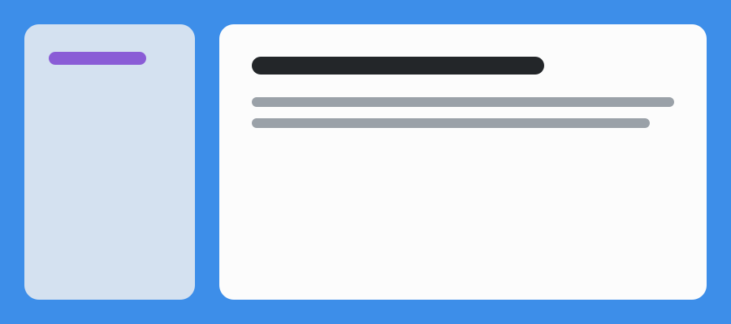

This site is built with [Hugo](https://gohugo.io/) and the Breeze Plasma theme. Pages are plain HTML and CSS with a little optional JavaScript.

A small inline image stays inline: , and a bare standalone image without a title is just an image:

